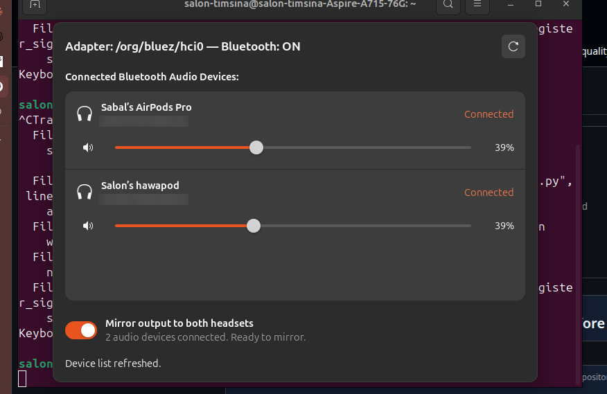

# SoundMirror

Desktop app for Ubuntu that mirrors audio output to two Bluetooth headsets
(e.g. two pairs of AirPods) at the same time.

## How it feels to use it



## Requirements

- Ubuntu (tested on 22.04/24.04)
- Rust toolchain (`rustc`, `cargo`)
- `libgtk-4-dev`, `libadwaita-1-dev`
- PulseAudio (module-combine-sink)

Install deps:

```bash
sudo apt install libgtk-4-dev libadwaita-1-dev pulseaudio
```

## Build & Run

1. Clone and enter the repository:
```bash
git clone <this-repo> soundmirror
cd soundmirror
```

2. Build optimized release binary:
```bash
cargo build --release
```

3. Run the app:
```bash
cargo run --release
```

### (Optional) Install to `~/.local/bin` to run from anywhere

Symlink the release binary into your user binary path:

```bash
mkdir -p ~/.local/bin
ln -sf "$(pwd)/target/release/soundmirror" ~/.local/bin/soundmirror
```

**What this command does:**
- `mkdir -p ~/.local/bin`: Ensures the `~/.local/bin` folder exists in your home directory.
- `ln -sf <target> <link_name>`:
  - `ln`: Creates a link between files.
  - `-s` (symbolic): Creates a soft shortcut/symlink pointing to the original file.
  - `-f` (force): Automatically overwrites any existing link with that name.
- As long as `~/.local/bin` is in your `$PATH`, you can simply run `soundmirror` from any directory without any runtime dependencies.

## How it works

1. Connect both of your Bluetooth headsets (e.g. AirPods) using Ubuntu's native Bluetooth Settings.
2. Launch SoundMirror (`soundmirror`). Any connected headsets automatically show up in the list in real-time.
3. Toggle **Mirror output to both headsets**.
4. If you notice clock drift or buffer delay between headsets after extended playback, click **Fix Delay** to immediately resync both audio streams live.

This creates a PulseAudio combined sink (`module-combine-sink`) configured with `adjust_time=1` to actively resynchronize clock drift every 1 second.

## Features

- **Automatic Live Headset Detection:** Detects newly connected or disconnected Bluetooth headsets in real time.
- **Independent Volume & Mute:** Adjust each person's listening volume separately or mute individually.
- **Fix Delay / Live Resync:** One-click buffer flush that eliminates accumulated A2DP latency drift on the fly without stopping playback.
- **Native Rust & GTK4 / Libadwaita:** Lightning-fast launch, low memory usage, and native Ubuntu GNOME design.

## Caveats

- **A2DP only:** Headset/HFP mode (microphone) uses a different profile and
  won't be mirrored this way.
- **PipeWire:** Ubuntu 24.04+ may use PipeWire, which does not support
  `module-combine-sink`. This build targets PulseAudio.
